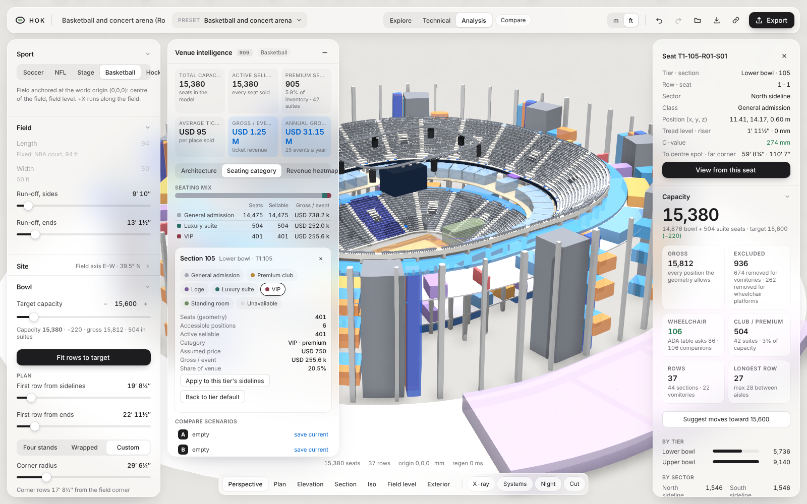
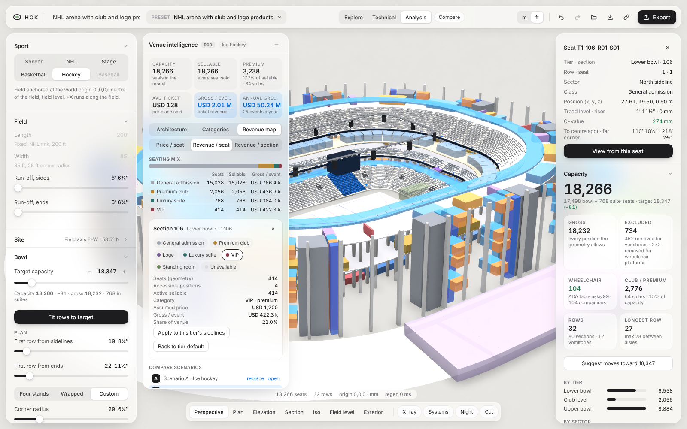
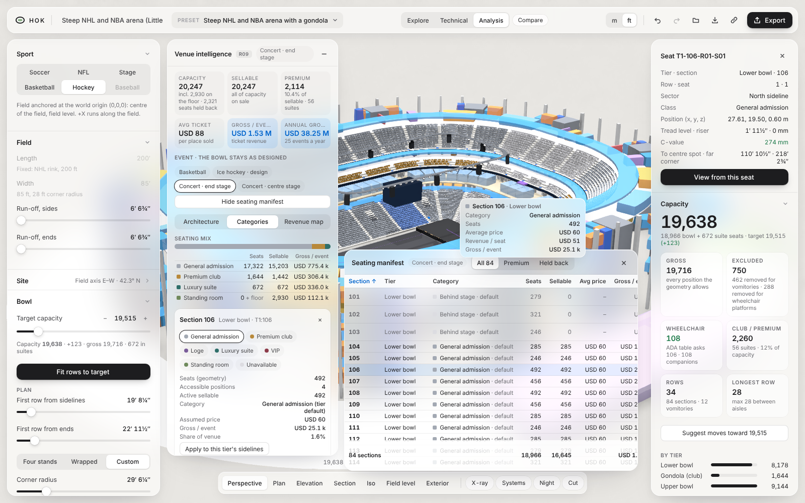
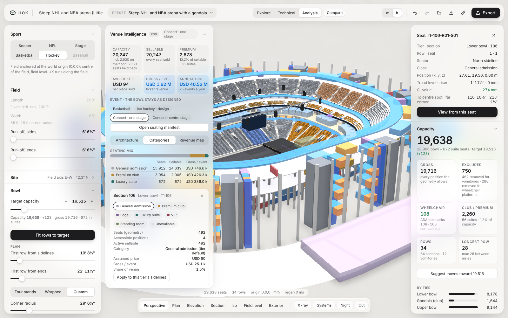

# Venue intelligence (Round 09)

Venue intelligence connects the bowl to its seating inventory and an illustrative gross ticket revenue. The parametric engine stays the source of truth for physical seats. The seating mix and the revenue assumptions only say how those seats are sold. The code is in `src/core/venue.ts` (pure, no UI) and `src/ui/VenuePanel.tsx`.

This is a proof of concept for early design comparison. It is not connected to, and does not reproduce, HOK's Scrum tool, and it is not endorsed by HOK. The prices are placeholders, not data from any project.

## Data

| Where | What |
|---|---|
| `project.mix` | The product each bowl section sells as, keyed `tierId:section` (for example `T1:104`). Sections left out follow their tier: a club tier sells as club, any other as general admission. |
| `project.studies.revenue` | Events a year, sell-through (`occupancy`), a price per product per event, the annual suite licence, seats per converted suite, and a conversion ratio per product. Extended from the Round 07 revenue study. |
| `project.sport` | The event the bowl is configured for. Basketball, hockey, soccer, NFL and the stage floor are real geometry: switching regenerates the bowl. |
| Seat table | Physical seats per section: active positions only (vomitories, platforms and excluded seats never count). Wheelchair and companion positions are counted separately. |
| `building.suites` | Suites on premium levels, each with its seats. |

Section keys come from the engine's section labels, so the mix travels with the design (scenarios, undo, autosave, share links, the project file) and a different preset never inherits another venue's mix. Mix entries that no longer match a section after a geometry change are reported and ignored.

## Method

| Product | Sellable places | Revenue per event |
|---|---|---|
| General admission | seats | sellable × sell-through × price |
| Club, loge, VIP | ⌊(seats − accessible) × conversion⌋ + accessible | sellable × sell-through × price |
| Standing room | as above, only for events with standing (soccer, the stage floor); otherwise 0 | as above |
| Suite (bowl section) | suites × seats per suite + accessible, with suites = ⌊(seats − accessible) × conversion ÷ seats per suite⌋ | suites × licence ÷ events + accessible × sell-through × per-seat suite price |
| Suite (premium level) | the level's suite seats | suites × licence ÷ events |
| Unavailable | 0 | 0 |

- Annual gross = revenue per event × events. A suite licence is therefore earned once a year whatever the event count, and never as seats × a ticket price.
- A conversion of 100% re-prices the section and keeps every seat. Less than 100% models a physical conversion explicitly, and the section card says so. Accessible positions are never scaled.
- Premium inventory = sellable places in club, loge, VIP and suites. Premium mix = premium ÷ sellable.
- Average ticket = gross per event ÷ places sold per event (sellable × sell-through, with suite seats counted as sold).
- A section held back as unavailable withholds its accessible positions, and the panel warns when the remaining wheelchair positions fall below the ADA table.

## Events

The model runs for one operating event (`project.event`; empty means the design event). Arenas offer basketball, hockey, an end-stage concert and a centre-stage concert; stadiums offer football, soccer and an end-stage concert; concert halls offer the two concerts. An event never moves a seat and never re-solves the bowl: sightlines and C-values stay those of the design event, and only the floor and what is sold change ([`core/events.ts`](../src/core/events.ts), rule `hok.event.floor`).

- **Sports** lay their rule-size field, with run-off, centred inside the first-row line less a 1.5 m clearance zone. If it doesn't fit, the event is listed as unsupported with the dimensions, and the model stays on the design event. For example, a hockey rink doesn't fit a bowl built tight round a basketball court, because retractable seating is not modelled.
- **End stage**: 16 m deep and up to 40 m wide at the east end of the floor. Bowl sections whose centre lies past the stage front, within the width of the floor, are held back for the event. Their seats leave the event capacity, and their accessible positions count as withheld in the checks.
- **Centre stage**: 15 m square, holding nothing back.
- **Concert floor**: the open floor (less the stage) sells standing places at an editable density, 1.5 per m² by default, at the standing price. They are added to capacity, sellable places and the standing product.

    event capacity = seats in use + suite seats − seats behind an end stage + floor standing

Not modelled: retractable seating, partial obstruction beside a stage, a seated floor, a separate seating mix or prices for each event, and an annual mix of events. The annual figure assumes every event is the one shown.

## Manifest and hover

The seating manifest (`M`, or *Open seating manifest*) lists every bowl section with its tier, category, seats, sellable places, average price and gross per event. You can sort it by any column and filter it to premium or held-back sections. Clicking a row selects the section in 3D, and a section picked in 3D scrolls its row into view. In the *Categories* and *Revenue map* views, hovering over a seat shows a card for its section.

## Exports

From the panel's **Export** group, or the toolbar's Export menu under *Venue intelligence*:

- **Seating manifest `.csv`**: one row per bowl section for the event shown, with these columns: key, section, tier, region, category, premium, held back, seats, accessible, sellable, suites, average price, gross per event and note. A row for the suite levels and one for the concert floor follow, when the design has them, so the gross and sellable columns add up to the dashboard.
- **Financial assumptions `.json`** (`hok.venue-assumptions` v1): the revenue assumptions, plus the seating mix and event for reference. *Import assumptions…* applies a file's assumptions to the open design and never changes its mix. A damaged value keeps its default and is reported.
- **Scenario comparison `.json`** (`hok.venue-scenarios` v1): A and B, each with its own figures, assumptions and mix, the signed deltas B − A and the sections sold differently.

Every file carries the illustrative-revenue disclaimer. The Rhino, IFC, glTF and DXF exports are unchanged.

## Scenarios

Scenario A and B each store the whole project (geometry, mix, event and assumptions) and the figures worked out when they were saved, in `localStorage` under `hok.venue-ab.v1`. Changing the current assumptions never rewrites a saved scenario. Opening a scenario loads it as the current design; *update* saves it back to its slot. *Show changed sections in 3D* washes amber every section sold differently in A and B, including sections held back by an event.

## Presets

Every precedent-informed preset is labelled *Reference-inspired concept — not as-built geometry.* Published capacities by event are stored with their sources in the precedent library (`capacities`), apart from the model's seat count, and each precedent records HOK's actual role (`attribution`): HOK design, HOK with a co-designing studio, HOK renovation of another studio's building, ROSSETTI legacy, ROSSETTI collaboration, or independent. See [PRECEDENTS.md](PRECEDENTS.md).

Arena bowls start their first riser row 6 m from the court or rink (7 m at the ends). Courtside floor seats and the shallow front rows at the hockey glass are not modelled, because a full riser bowl closer in cannot meet the C-value at the field line.

## Not yet built

- A separate seating mix and prices for each event, and an annual mix of events.
- The Round 07 revenue study in **Design studies** still uses its own simpler formula (it ignores the mix and prices accessible positions in club tiers as general admission); folding it into this model would change its existing figures.

## Screenshots

